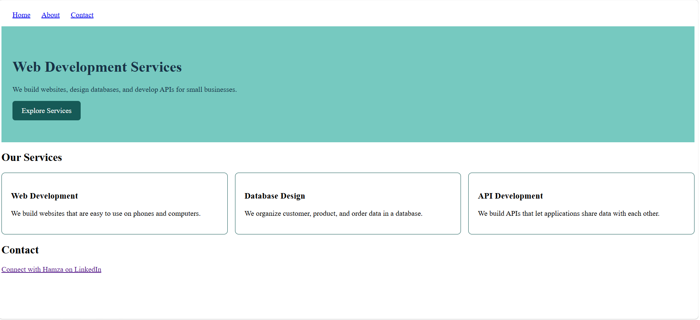
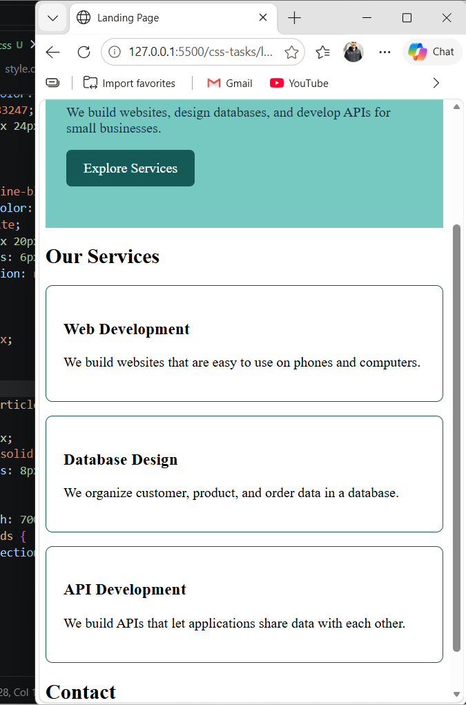
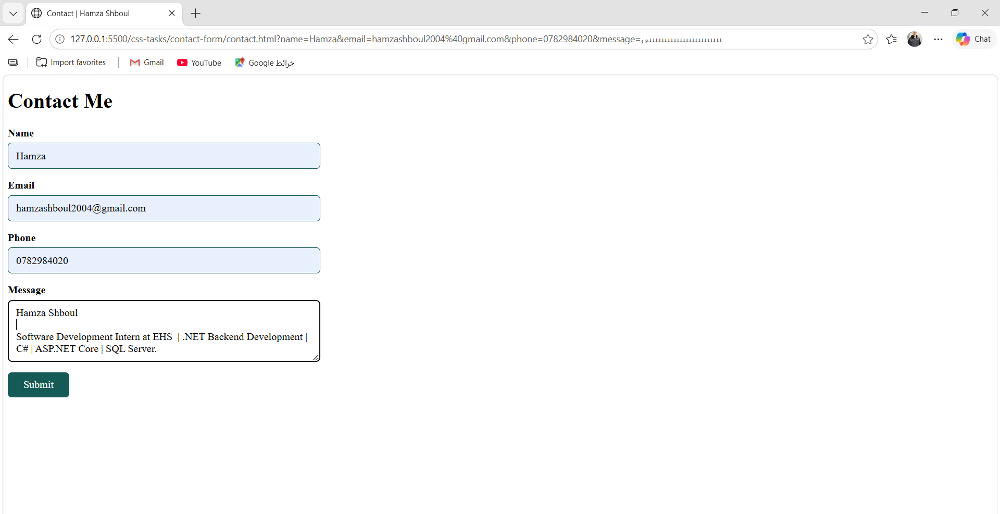

# css-tasks
CSS exercises for my EHS internship, including a styled profile page, a responsive landing page, and a styled contact form.
## Task 1 — Styled Profile Page

## Task 2 — Responsive Landing Page

### Wide screen

### Narrow screen

## Task 3 — Styled Contact Form

